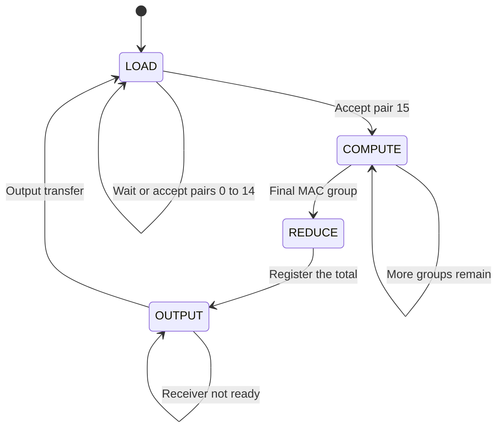
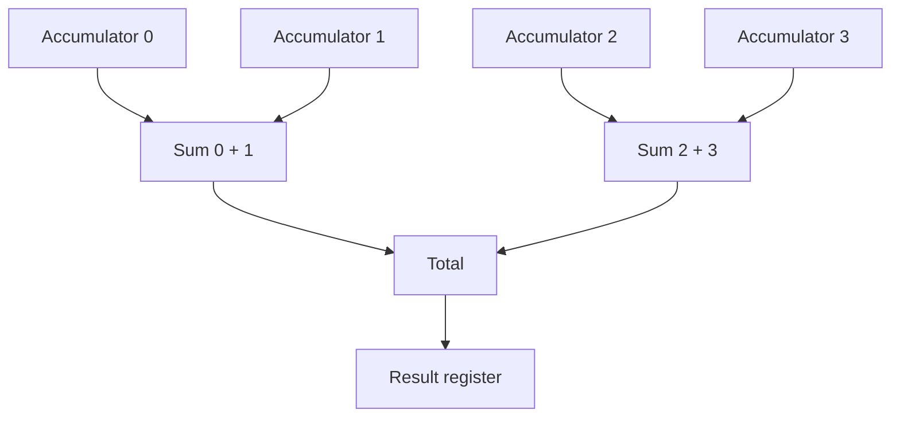

# Architecture: a buffered dot-product accelerator

This project computes one signed integer dot product:

\[
y=\sum_{i=0}^{15}a_i b_i.
\]

Each input number is an 8-bit signed integer, and the output is a 20-bit signed integer. The two default implementations use the same input protocol and the same four-state controller. Their difference is the number of multiply–accumulate paths inside the computation stage.

| Implementation | Wrapper | MAC lanes | Products processed per compute clock |
| --- | --- | ---: | ---: |
| Sequential | `rtl/dot_product_serial.v` | 1 | 1 |
| Parallel | `rtl/dot_product_parallel.v` | 4 | 4 |

Both wrappers instantiate `rtl/dot_product_core.v`, with a different constant value of `LANES`. These are two physical hardware configurations of one parameterized design. `LANES` is fixed when the design is elaborated; it is not a run-time mode input. A comparison system that instantiates both wrappers contains both engines.

## 1. The input and output contract

One transaction, called a **frame**, consists of exactly 16 accepted pairs. The first pair is `(a[0], b[0])`, followed by `(a[1], b[1])`, through `(a[15], b[15])`. There is no `start` or `last` signal on the core interface: the controller counts accepted pairs.

| Port | Direction | Default width | Meaning |
| --- | --- | ---: | --- |
| `clk` | Input | 1 | All stored state changes on rising edges. |
| `rst` | Input | 1 | Active-high synchronous reset; cancels the current frame. |
| `in_valid` | Input | 1 | The source is offering a pair on `in_a` and `in_b`. |
| `in_ready` | Output | 1 | The engine can accept that pair. |
| `in_a` | Input | 8 | Signed two's-complement value from vector A. |
| `in_b` | Input | 8 | Signed two's-complement value from vector B. |
| `out_valid` | Output | 1 | `result` contains a pending output. |
| `out_ready` | Input | 1 | The receiver can accept that output. |
| `result` | Output | 20 | Signed two's-complement dot product. |

An **input transfer** occurs on a rising edge when `in_valid && in_ready` is true. If `in_valid` is zero, no pair is counted. The source may pause between any two pairs. Once the source offers a valid pair, it must keep `in_valid`, `in_a`, and `in_b` stable until the engine accepts that pair, unless reset cancels the transfer.

An **output transfer** occurs on a rising edge when `out_valid && out_ready` is true. The receiver can keep `out_ready` low for as long as necessary. The engine holds `out_valid` high and keeps `result` unchanged throughout that wait. This is output **backpressure**.

The engine accepts only one frame at a time. It does not accept inputs while computing or while holding an output. When an output transfers, the controller returns to `LOAD`; the earliest next input transfer is the following rising edge. A source may already be holding the first pair of that next frame valid during the wait.

The result bus can still contain the previous result while the next frame loads. Its value is meaningful as an output transaction only when `out_valid` is high.

### Reset semantics

Hold `rst` high across at least one rising clock edge. That edge clears the controller, counters, accumulators, and result register. It abandons any partly loaded frame, calculation, or unconsumed output. After reset, send a complete new frame beginning with index 0.

`in_ready` and `out_valid` are additionally gated by `!rst`, so they are low whenever reset is asserted. Stored state still resets synchronously on a rising edge. The input memories are not cleared: all 16 entries must be overwritten before another calculation can begin, making their old contents irrelevant.

## 2. The four states



Reset takes priority over every state and returns the engine to `LOAD`.

| State | What changes at a rising edge | Interface behavior |
| --- | --- | --- |
| `LOAD` | An accepted pair is written into the two input buffers. The last pair also clears lane sums and the group counter. | `in_ready=1`; `out_valid=0`. |
| `COMPUTE` | Each lane multiplies one buffered pair and adds it to that lane's accumulator. | `in_ready=0`; `out_valid=0`. |
| `REDUCE` | The sum of all lane accumulators is copied into `result`. | `in_ready=0`; `out_valid=0` before this edge. |
| `OUTPUT` | State returns to `LOAD` if the receiver accepts the result. | `in_ready=0`; `out_valid=1`. |

The table assumes `rst=0`. Immediately after the `REDUCE` edge, state becomes `OUTPUT`, so `out_valid` becomes high.

## 3. Where the parallelism comes from

Both implementations first store the two vectors in buffers: 16 numbers × 8 bits × 2 vectors = 256 bits of input data. Storage implementation and overhead depend on synthesis.

The sequential configuration reads one pair per compute clock and accumulates all 16 products into one lane sum. The parallel configuration reads four buffered pairs per compute clock. Each lane owns its own sum, so four MAC updates happen at the same edge.

| Compute group | Lane 0 index | Lane 1 index | Lane 2 index | Lane 3 index |
| ---: | ---: | ---: | ---: | ---: |
| 0 | 0 | 1 | 2 | 3 |
| 1 | 4 | 5 | 6 | 7 |
| 2 | 8 | 9 | 10 | 11 |
| 3 | 12 | 13 | 14 | 15 |

The address rule is `group_index * LANES + lane`. Each product is used exactly once. After the four groups, the lane sums are combined by a balanced tree:



The tree is combinational; only its final total is registered in the `REDUCE` state. It is not a multistage pipeline. For a one-lane engine, reduction is simply a connection from the sole accumulator to the result register, but it retains the same one-cycle controller stage.

The `generate` loop creates the lane circuits during elaboration. It does not run lane 0 first and lane 1 later. Likewise, the bounded `for` loop inside the clocked block updates all lane registers on the same edge. **The clock and group counter introduce time sequencing; the lane loops describe replicated hardware.**

### Worked example

For the built-in example, `a[i] = i - 8` and `b[i] = i + 1`:

```text
a = [-8, -7, -6, -5, -4, -3, -2, -1, 0, 1, 2, 3, 4, 5, 6, 7]
b = [ 1,  2,  3,  4,  5,  6,  7,  8, 9,10,11,12,13,14,15,16]
```

| Lane | Products accumulated | Partial sum |
| --- | --- | ---: |
| 0 | `-8 - 20 + 0 + 52` | 24 |
| 1 | `-14 - 18 + 10 + 70` | 48 |
| 2 | `-18 - 14 + 22 + 90` | 80 |
| 3 | `-20 - 8 + 36 + 112` | 120 |

The tree produces `(24 + 48) + (80 + 120) = 272`. The sequential engine visits those same 16 products in index order and obtains the same result.

## 4. Signed numbers and accumulator width

An 8-bit signed input represents integers from −128 to +127. A full product is kept in a signed 16-bit wire. The product is then **sign-extended** to the accumulator width: its sign bit is repeated into the additional upper bits. Extending a negative number with zeros would change its value.

The largest positive product is `(-128) × (-128) = 16,384`; the most negative product is `(-128) × 127 = -16,256`. Therefore the 16-term dot product can reach:

\[
y_{\max}=16\times16{,}384=262{,}144,
\qquad
y_{\min}=16\times(-16{,}256)=-260{,}096.
\]

A signed 19-bit value has a maximum of `2^18 - 1 = 262,143`, which is **one too small** for the positive extreme. The design therefore uses 20-bit signed accumulators and a 20-bit signed result. The 20-bit signed range is −524,288 to +524,287.

The general conservative width rule used by the core is:

\[
\text{ACC\_WIDTH} = 2\times\text{DATA\_WIDTH}
                       + \lceil \log_2(\text{VECTOR\_LEN})\rceil.
\]

For a vector length of 1, the extra term is zero. Every lane accumulator and every reduction-tree node uses this width. No saturation, rounding, truncating quantizer, or floating-point arithmetic is implemented.

Valid core parameters require `VECTOR_LEN >= 1`, `DATA_WIDTH >= 2`, `1 <= LANES <= VECTOR_LEN`, and `VECTOR_LEN % LANES == 0`. `ACC_WIDTH` must meet the width rule above. The parallel wrapper fixes `LANES=4`, so its vector length must be divisible by four. Simulation checks reject invalid combinations.

## 5. Why the code uses `<=` and a separate reduction edge

An `always` block alone does not decide the assignment operator. The question is whether you are describing clocked storage or combinational calculation.

The core's state-changing block is `always @(posedge clk)`. Its nonblocking assignments, `<=`, evaluate right-hand sides using the values that existed before the edge, then update the registers. Thus:

```verilog
lane_accumulator[k] <= lane_accumulator[k] + extended_product[k];
```

means “store the old sum plus this group's product.” All lanes update together. Changing state to `REDUCE` at that same edge does not execute the `REDUCE` case immediately: the current case branch was selected using the old state.

At the next edge, the reduction tree sees the completed accumulator values. That is when the controller stores the total into `result`. If the result were captured from the old accumulator sums on the final compute edge, it would omit the last group's products.

The combinational product and tree connections use continuous `assign` statements. In a separate `always @(*)` block describing combinational logic, the usual choice would be blocking assignment, `=`, with every output assigned on every path. This core uses continuous assignments for those datapaths, so it does not need such a block.

## 6. Exactly what is faster

Assume no input pauses, the receiver is always ready, and reset has finished. Number the rising edge accepting the first input pair as **edge 1**.

| Activity | Sequential | Four lanes |
| --- | --- | --- |
| Accept 16 input pairs | Edges 1–16 | Edges 1–16 |
| Perform MAC updates | Edges 17–32 | Edges 17–20 |
| Register final result | Edge 33 | Edge 21 |
| `out_valid` first becomes high | Immediately after edge 33 | Immediately after edge 21 |
| Earliest output transfer | Edge 34 | Edge 22 |
| Earliest first input of the next frame | Edge 35 | Edge 23 |

These give several different, valid performance comparisons:

| Metric | Sequential | Four lanes | Ratio |
| --- | ---: | ---: | ---: |
| MAC-stage clocks | 16 | 4 | 4.00× |
| Last input edge → output-valid edge, in elapsed periods | 17 | 5 | 3.40× |
| First input edge → output-valid edge, in elapsed periods | 32 | 20 | 1.60× |
| Steady-state frame initiation interval, including loading and retirement | 34 | 22 | 1.545× |

The elapsed-period measurements subtract edge numbers; for example, `33 - 1 = 32`. The frame initiation interval compares first-input edges of successive frames: `35 - 1 = 34`. Keeping these definitions separate prevents an off-by-one claim.

**The parallel interface still accepts one pair per input clock.** Its four internal lanes draw from the buffers after loading. Input transfer costs 16 clocks in either design, so a fourfold MAC-stage improvement becomes about a 1.55-fold improvement in complete-frame throughput at the same clock frequency. Input pauses or output backpressure add further waiting time.

This is a deliberately buffered baseline for studying lane replication. A sequential design that performs a MAC during each input transfer could avoid much of this loading/computing separation. Implementing that alternative and comparing it fairly is a useful next experiment.

## 7. What the measurements establish

Simulation checks arithmetic and protocol behavior and measures clock counts. A 10 ns testbench clock corresponds to an assumed 100 MHz clock. It does **not** prove that a synthesized and routed FPGA implementation meets 100 MHz timing. Under that assumption alone, a 34-cycle frame interval is 340 ns and a 22-cycle interval is 220 ns.

Synthesis reports describe the resources used by the specified tool and target mapping. Keep DSP blocks, lookup tables, flip-flops, and memory resources separate. Resource counts are not measurements of power or energy, and cycle counts alone are not measurements of clock frequency. Physical timing, board operation, and power require their own implementation and measurement steps.

The verification approach uses an independent Python arithmetic model and randomized inputs, as illustrated by the [official cocotb example](https://docs.cocotb.org/en/stable/matrix_multiplier.html). See the repository's generated reports for the actual results of this implementation.
