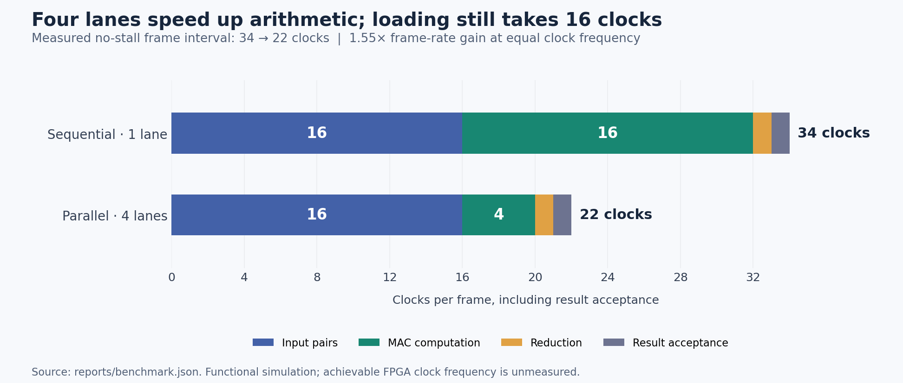

# Measured project results

The four-lane design completes the MAC loop in four clocks instead of sixteen. With the shared input protocol, the measured no-stall frame interval improves from **34 to 22 clocks**, a **1.545× frame-rate improvement at equal clock frequency**.

RTL verification: **40 simulation tests passed** across **10 configurations**, with **1,732 checked results** and **7 Python reference tests**. Random seed: `20261029`. Quick mode: `False`.

Recorded tools: Python 3.12.14, cocotb 2.0.1, Icarus Verilog version 12.0 (stable) (); Yosys 0.33 (git sha1 2584903a060).

## Cycle measurements

| Measurement | Sequential | Four lanes |
|---|---:|---:|
| MAC lanes | 1 | 4 |
| Accepted input clocks | 16 | 16 |
| MAC clocks | 16 | 4 |
| Reduction/output-register clocks | 1 | 1 |
| First input through result visible, inclusive edges | 33 | 21 |
| First input through result accepted, inclusive edges | 34 | 22 |
| No-stall frame initiation interval | 34 | 22 |
| Frame interval with 15 input gaps and 6 output stalls | 55 | 43 |

A frame contains sixteen accepted pairs. The first input edge and the result-acceptance edge both count in the inclusive-edge total. The frame initiation interval measures the spacing between first-input edges of consecutive frames. Elapsed first-input-to-result-acceptance time instead spans 33/21 periods, since it excludes the starting edge. See `benchmark.json` for the raw edge numbers and four repetitions per scenario.

There are 16 input clocks, N/LANES MAC clocks, one reduction clock and one result-acceptance clock. More lanes do not shorten the input phase. Input pauses and output backpressure add directly to the frame interval in this non-overlapped architecture.

## Mapped hardware resources

Core-only mapping to Xilinx 7-series primitives, before placement and routing. The input buffers and controller are included; board IO and clock buffers are excluded.

| Architecture | Mapping | DSP48 blocks | Logic LUT primitives | Fabric FF | RAM32M primitives |
|---|---|---:|---:|---:|---:|
| serial | dsp | 1 | 48 | 56 | 16 |
| parallel | dsp | 4 | 156 | 112 | 32 |
| serial | lut | 0 | 276 | 56 | 16 |
| parallel | lut | 0 | 1102 | 112 | 32 |

Logic LUT counts exclude distributed-memory primitives. RAM32M consumes LUT resources and is therefore shown alongside the logic counts. Fabric FF excludes registers inside DSP/RAM primitives. These different resources cannot be added into one meaningful area number.

The parallel mapping uses extra arithmetic, reduction and memory-access resources. The input arrays support more simultaneous reads; the mapped result demonstrates that parallelism can affect storage/access hardware as well as multipliers. Explicit memory banking is a useful next optimization experiment.

Raw executed commands, tool output, complete cell counts and RTL hashes are retained in `synthesis/`. Resource totals may change with synthesis version and mapping choices.

## Synthesized circuit verification

**16 mapped-netlist tests passed**, checking **248 results** across four DSP-enabled/LUT-only implementations. Separate evidence is included in `netlist_verification.json`, with per-run logs in `netlist_logs/`. It checks the synthesized circuits using functional Xilinx primitive models. No routed delays or timing annotation are present.

## Basys 3 integration

The separate board-wrapper simulation passes the documented known-vector/button/reset checks; see `board_smoke.log`. Both engines return 272, and completed LEDs read `0x1107`. Physical board execution and Vivado place/route have not been performed for this snapshot.

## What the measurements support

The evidence supports functional correctness for the exercised scenarios, the measured cycle counts, and the listed mapped resource counts. It does not establish maximum clock frequency, physical area, measured energy/power savings, or classifier accuracy. The simulation clock is 10 ns; successful simulation at that period is not timing closure. The 100 MHz board constraint remains a target until routing and timing checks pass.

## Evidence files

- `verification.json`: configuration outcomes, test scenarios, event counts and source hashes.
- `benchmark.json`: raw transaction edges, latency definitions and repeated measurements.
- `synthesis/summary.json`, `.csv`, `.md`: mapped resource totals and source hashes.
- `synthesis/*_stat.json`, `.ys`, `.log`: detailed statistics, commands and tool logs.
- `rtl_logs/`: simulator compilation, execution and JUnit evidence.
- `netlist_verification.json`, `netlist_logs/`: synthesized circuit checks.
- `board_smoke.log`: board-wrapper functional smoke-test result.

## Cycle breakdown

